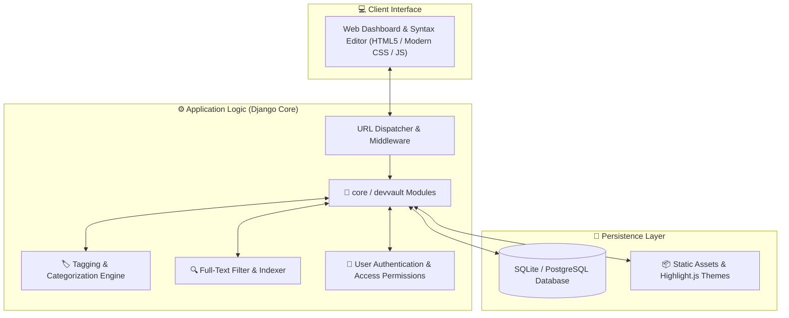

<div align="center">

# 🔐 CodeVault — Secure Developer Snippet & Knowledge Vault

[](https://www.python.org/)
[](https://www.djangoproject.com/)
[](#)
[](#)

<p align="center">
  <b>A modern, developer-centric repository for organizing, tagging, searching, and safeguarding code snippets, algorithms, configurations, and technical notes.</b>
</p>

---

</div>

## 📌 Overview

**CodeVault** is engineered for developers who need instant access to their personal library of trusted code snippets, reusable patterns, and technical cheat-sheets. Featuring full-text search, syntax highlighting, and categorized tagging, CodeVault ensures your most important scripts and algorithms are never lost.

---

## 🏛️ System Architecture



---

## 🌟 Core Features

- **Multi-Language Syntax Highlighting**: Clean visualization for Python, C/C++, Java, JavaScript, SQL, Bash, and more.
- **Tag-Based Taxonomy**: Organize snippets by project, technology, utility, or algorithm type.
- **Fast Search & Filtering**: Instant keyword lookup across snippet titles, tags, and code contents.
- **Private & Public Visibility**: Toggle whether snippets are visible only to the authenticated owner or shared across teams.
- **One-Click Copy & Export**: Instant clipboard integration and raw file download.

---

## 📂 Repository Structure

```plaintext
codevault/
├── 📁 devvault/               # Django root project configuration
├── 📁 core/                   # Snippet models, views, and forms
├── 📁 src/                    # Source frontend assets & scripts
├── 📁 staticfiles/            # Compiled CSS, JS, and syntax themes
├── 📄 manage.py               # Django administrative CLI
├── 📄 package.json            # Node.js dependencies & scripts
├── 📄 requirements.txt        # Python backend dependencies
└── 📄 README.md               # Documentation
```

---

## ⚡ Installation & Setup

1. **Clone the repository:**
   ```bash
   git clone https://github.com/MominRifat/codevault.git
   cd codevault
   ```

2. **Set up virtual environment:**
   ```bash
   python -m venv venv
   # On Windows:
   venv\Scripts\activate
   # On Linux/macOS:
   source venv/bin/activate
   ```

3. **Install dependencies:**
   ```bash
   pip install -r requirements.txt
   ```

4. **Initialize database & launch:**
   ```bash
   python manage.py makemigrations
   python manage.py migrate
   python manage.py runserver
   ```
   *Access your vault at `http://127.0.0.1:8000/`.*

---

## 👨‍💻 Author

**Momin Rifat**  
- GitHub: [@MominRifat](https://github.com/MominRifat)  
- Location: Dhaka, Bangladesh
