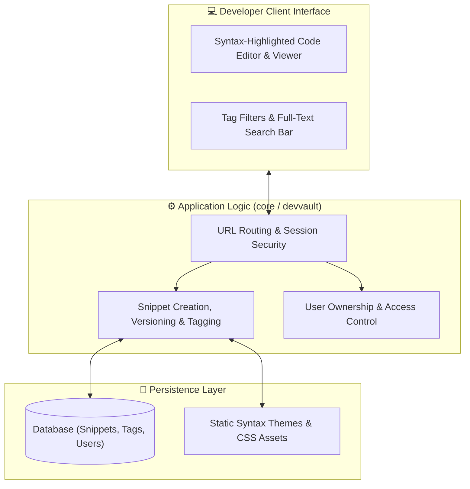

<div align="center">

# 🔐 CodeVault — Secure Developer Snippet & Knowledge Vault

[](https://www.python.org/)
[](https://www.djangoproject.com/)
[](#)
[](#)
[](#)

<p align="center">
  <b>A full-stack developer productivity platform engineered to organize, catalog, tag, and protect personal code snippets, algorithms, and configuration templates.</b>
</p>

[📌 About the Project](#-about-the-project) • [🛠️ Tech Stack](#️-comprehensive-tech-stack) • [🏛️ Architecture](#️-system-architecture) • [🚀 How to Run](#-complete-how-to-run--setup-guide)

---

</div>

## 📌 About the Project

Developers frequently solve intricate bugs, write efficient algorithms, or configure complex deployment scripts—only to lose track of them across various machines. 

**CodeVault** is a dedicated digital sanctuary where programmers can index reusable code snippets with syntax highlighting, tag snippets by domain/framework, toggle public vs private confidentiality, and instantly search their entire technical knowledge base.

---

## 🛠️ Comprehensive Tech Stack

| Domain | Technology | Specification / Role |
| :--- | :--- | :--- |
| **Backend Framework** | **Django** | Handles authentication, snippet CRUD operations, and tag filters |
| **Language** | **Python 3.10+** | Server execution and business logic |
| **Database** | **SQLite3 / PostgreSQL** | Storage of encrypted/stored code blocks, metadata, and tags |
| **Syntax Highlighting** | **Highlight.js / Prism** | Real-time code formatting for 50+ programming languages |
| **Frontend Styling** | **Modern CSS3 + HTML5** | Glassmorphic dark IDE theme with responsive layouts |

---

## 🏛️ System Architecture



---

## 🚀 Complete How-To-Run & Setup Guide

### 1. Prerequisites
- **Python 3.10+** (`python --version`)
- **Git** (`git --version`)

---

### 2. Step-by-Step Installation

```bash
# 1. Clone repository:
git clone https://github.com/MominRifat/codevault.git
cd codevault

# 2. Create and activate virtual environment:
python -m venv venv
# On Windows:
.\venv\Scripts\activate
# On Linux / macOS:
source venv/bin/activate

# 3. Install dependencies:
pip install --upgrade pip
pip install -r requirements.txt

# 4. Run database migrations:
python manage.py makemigrations
python manage.py migrate

# 5. Create admin account:
python manage.py createsuperuser

# 6. Launch development server:
python manage.py runserver
```

Open your browser and navigate to:  
👉 **`http://127.0.0.1:8000/`**

---

## 👨‍💻 Author

**Momin Rifat**  
GitHub: [@MominRifat](https://github.com/MominRifat)  
Location: Dhaka, Bangladesh
